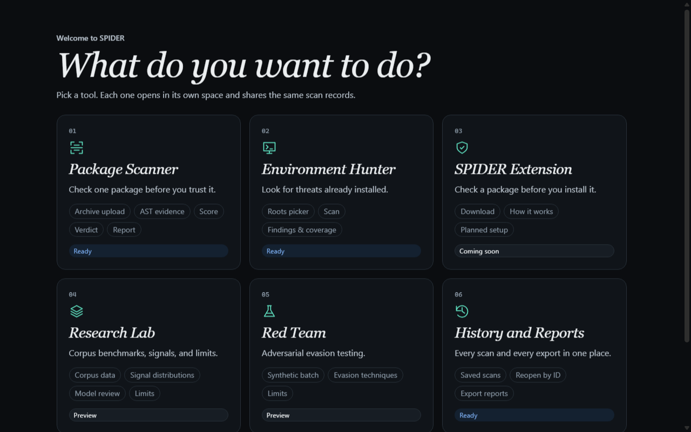
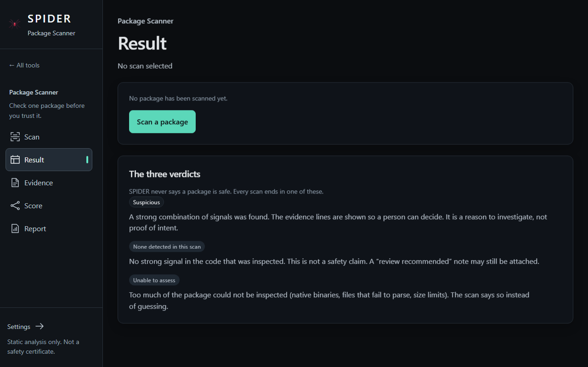
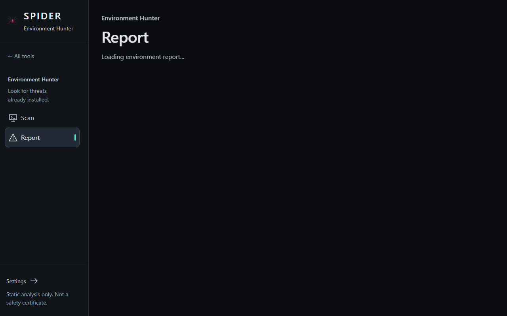
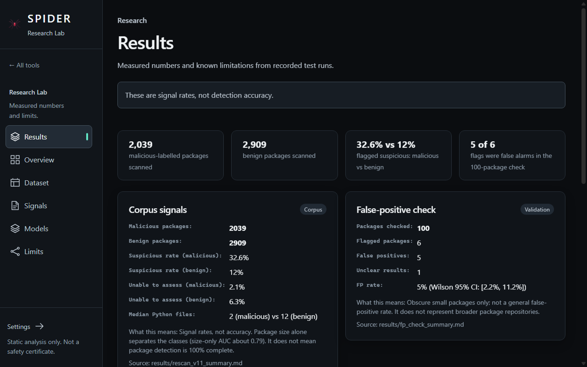
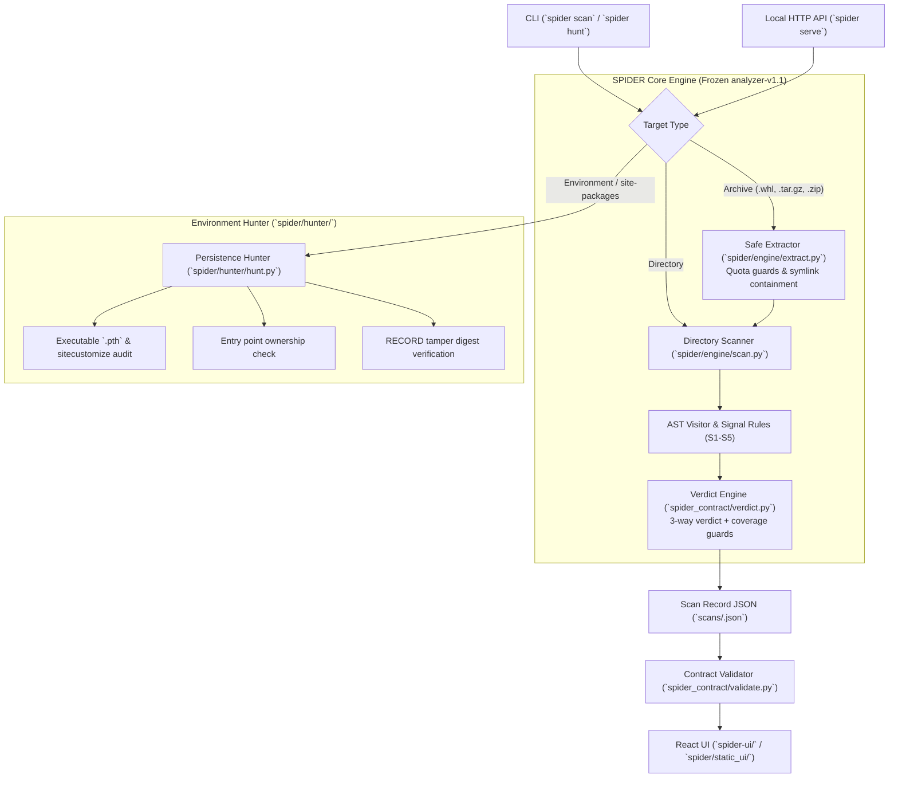

# SPIDER: Static Analysis for Python Packages

SPIDER is an offline static analysis engine, environment hunter, and research platform for inspecting Python packages for malicious code and persistence artifacts without executing anything.

It never executes untrusted code, never imports user packages, and enforces a strict 3-way verdict policy: **SPIDER never says "safe"**.

---

## 1. What It Tells You (3-Way Verdicts)

Every scan produces a structured, contract-validated JSON record (`scans/<scan_id>.json`) with exactly one of three verdicts:

| Verdict | CLI Exit Code | Meaning & Policy |
| :--- | :---: | :--- |
| `suspicious` | **10** | Strong malicious signal or high-confidence combination rule fired (e.g., install hook command execution, credential theft + exfiltration). Evidence snippets and spans are displayed. |
| `none_detected_in_this_scan` | **0** | No strong signal was detected in the inspected code. **This is strictly an absence of detection, never a safety claim**. A `review_recommended` flag may be raised for suspicious heuristics. |
| `unable_to_assess` | **20** | Insufficient code could be inspected to reach a sound decision (e.g. empty/docs-only directory, >20% parse failures, high uninspected file ratio, archive limit exceeded). |

*(Exit code **2** indicates an invocation or input error, such as a nonexistent path or invalid arguments).*

---

## 2. Quick Start

Requirements: **Python 3.10+**.

```bash
git clone https://github.com/HSR-009/SPIDER.git
cd SPIDER
python -m venv .venv
# Linux / macOS: source .venv/bin/activate
# Windows PowerShell: .venv\Scripts\Activate.ps1
pip install -r requirements-core.txt    # Or requirements.txt for optional ML packages

# Run the test suite (100% offline, stdlib unittest)
python -m unittest discover -s tests
```

### CLI Scanning & Hunting Examples

```bash
# 1. Scan a package directory or archive (.tar.gz, .zip, .whl)
python -m spider scan fixtures/src/demo-installhook      # Verdict: suspicious (Exit 10)
python -m spider scan fixtures/src/demo-httpclient       # Verdict: none_detected_in_this_scan (Exit 0)

# 2. Scan with JSON output formatted to stdout
python -m spider scan fixtures/src/demo-installhook --json

# 3. Hunt installed environment(s) for persistence artifacts (.pth code, hijacked entry points, tamper)
python -m spider hunt
python -m spider hunt --site-packages /path/to/site-packages --json
```

### Run the Local UI

No Node.js runtime required for normal use: the pre-built single-page app ships inside `spider/static_ui/`.

```bash
python -m spider serve                                  # Launches http://127.0.0.1:8000
python -m spider serve --port 8010 --no-browser         # Custom port, headless
```

*Security note: The API binds strictly to `127.0.0.1` / `localhost`, blocks external host headers/origins, and operates safely via memory/disk quotas without code execution.*

---

## 3. UI Screenshots

| Hub & Tool Navigation | Package Scanner Result & Evidence |
| :---: | :---: |
|  |  |

| Environment Hunter Report | Research Lab & Empirical Findings |
| :---: | :---: |
|  |  |

---

## 4. Architecture



For comprehensive architectural design, threat boundaries, and component interfaces, see [`docs/ARCHITECTURE.md`](docs/ARCHITECTURE.md).

---

## 5. Repository Layout & Team Responsibilities

The codebase reflects the collaborative work of three students across distinct sub-disciplines:

| Directory | Owner / Subsystem | Purpose & Contents |
| :--- | :--- | :--- |
| `spider/engine/` | **Person A** (Engine) | Safe extraction, AST rule inspection, strong signals S1–S5, directory scanning (frozen `analyzer-v1.1`). |
| `spider/hunter/` | **Person A** (Hunter) | Persistence detection in site-packages: `.pth` execution, `sitecustomize`, entry-point checks, RECORD tamper audits. |
| `spider_contract/` | **Person A** (Contract) | Semantic contracts, JSON schema specifications, and 3-way verdict validation. |
| `Person_A/` | **Person A** (Pipelines) | Corpus rescan pipelines, false positive evaluation (`fp_scan.py`), and dataset provenance scripts. |
| `Person_B/` | **Person B** (ML & Eval) | Feature extraction, grouped cross-validation, leak guards, XGBoost/SHAP evaluation, and ML methodology (read `docs/ML_METHODOLOGY.md` caveats before quoting any ML number). |
| `person_c/` | **Person C** (Adversarial) | Adversarial sample generator (`adv-batch-v1`), obfuscation transformations, and red-team test harness. |
| `spider-ui/` | **UI Frontend** (React) | React single-page app (TypeScript, Tailwind, 3D Canvas visualizer). |
| `spider/static_ui/` | Built Distribution | Committed production build of `spider-ui`, served by `spider serve`. |
| `results/` | Verified Data | Frozen evaluation results and metrics cited throughout documentation. |
| `docs/` | Documentation | Architecture, demo guide, methodology, threat model, and roadmap. |

---

## 6. What SPIDER Can and Cannot Do

### What it can do:
- **Inspect without execution:** Safely extracts and analyzes Python archives without importing modules or running `setup.py`.
- **Detect high-confidence malware patterns:** Strong signals for install hook commands (`S1`), dynamic code execution + network/obfuscation (`S2`), credential harvesting (`S3`), environment exfiltration (`S4`), and decoded execution (`S5`).
- **Audit installed Python environments:** Uncovers hidden persistence mechanisms in `.pth` files, non-standard `sitecustomize.py`, untracked entry points, and modified RECORD hashes.
- **Enforce decision boundaries:** Reports `unable_to_assess` when static coverage is compromised rather than generating false negatives.

### What it cannot do (Known limits):
- **Dynamic behavior:** Cannot detect code whose malicious behavior only manifests at runtime (e.g. dynamic reflection, C-extension payloads, environment-gated execution).
- **Compiled extensions:** C/C++ extensions (`.so`, `.pyd`) and binary executables are not disassembled or analyzed.
- **Large setup files:** Files exceeding the 2 MiB inspection limit are bypassed with limits noted in coverage.
- **Cross-file AST resolution:** Multi-stage payloads scattered across multiple modules without package-wide strong signal co-occurrence can evade AST analysis without normalization.
- **AI Agent prompts:** MCP tool descriptions and natural language prompt injection inside docstrings are not evaluated.

Full technical details and mitigations: [`docs/KNOWN_ISSUES.md`](docs/KNOWN_ISSUES.md) and [`docs/THREAT_MODEL.md`](docs/THREAT_MODEL.md).

---

## 7. Measured Results & Citations

All metrics presented below are directly reproduced from verified run artifacts in `results/`:

- **Corpus Evaluation (N=4,948 packages)**:
  - Malicious packages: 2,039 (`data/processed/malicious_v11.jsonl`)
  - Benign packages: 2,909 (`data/processed/benign_v11.jsonl.gz`)
  - Suspicious verdict rate: **32.6%** malicious vs **12.0%** benign (`results/rescan_v11_summary.md`).
  - Size confound caveat: Median analyzed `.py` files is 2 (malicious) vs 12 (benign); package size alone yields ROC-AUC ~0.79.
- **False-Positive Evaluation (N=100 obscure PyPI packages)**:
  - 6 packages flagged suspicious; manual triage confirmed 5 false positives and 1 unclear.
  - Estimated false positive rate: **5.0%** (Wilson 95% CI: [2.2%, 11.2%]) on small obscure packages (`results/fp_check_summary.md`).
- **Adversarial Resilience (N=12 synthetic samples)**:
  - Evaluated on frozen `adv-batch-v1` (Manifest SHA-256: `bb7f4fe8...`).
  - Baseline v1 AST missed 8 of 12 samples (66.7% evasion rate). Hardened v1.1 AST missed 0 samples at finding-level, with 1 reaching `suspicious`, 5 keeping review flags, and 6 silent (`results/adv_batch_verification_by_A.md`, `results/evasion_table_v1_vs_v11.md`).
  - Note the distinction between finding-level and verdict-level: finding-level measures whether any indicator fired on the code, whereas verdict-level measures whether the package as a whole reached a `suspicious` decision.

---

## 8. Development & Project Roadmap

- **Run UI development server**: `cd spider-ui && npm install && npm run dev`
- **Rebuild and publish static UI**: `cd spider-ui && npm run build:serve`
- **Future plans & ML roadmap**: See [`docs/ROADMAP.md`](docs/ROADMAP.md) for planned dynamic sandboxing, dependency graph inspection, and calibrated model integration.
- **Live demo walkthrough**: See [`docs/DEMO.md`](docs/DEMO.md) for a step-by-step evaluator guide.
