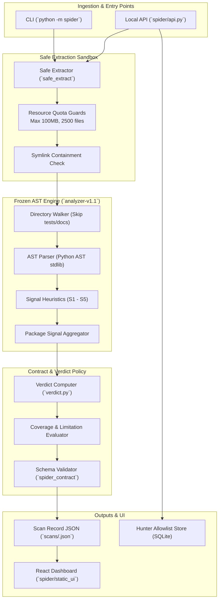

# SPIDER Architecture

This document describes the high-level architecture of SPIDER, its runtime data flow, execution boundaries, and safety guarantees.

## 1. System Overview

SPIDER is an offline static security analysis suite specifically designed for Python package ecosystems. It consists of three primary operational subsystems:

1. **Package Scanner (`spider/engine/`)**: Safely inspects untrusted source directories and archives (`.tar.gz`, `.whl`, `.zip`) using AST visitors without executing code.
2. **Environment Hunter (`spider/hunter/`)**: Audits local Python environments (`site-packages`) for malicious persistence mechanisms, tampered packages, and entry point hijacks.
3. **Investigation & Research UI (`spider-ui/` & `spider/api.py`)**: An interactive dashboard for reviewing scan records, exploring evidence trees, analyzing corpus distributions, and testing evasion samples.

---

## 2. Component Diagram

---

## 3. Core Subsystems

### Safe Extractor (`spider/engine/extract.py`)
Untrusted archives pose immediate decompression risks (zip bombs, path traversals, arbitrary symlinks). The safe extractor enforces:
- **Path Traversal Protection**: Strictly prevents `..` and absolute paths outside the extraction directory.
- **Symlink Disallowance**: Refuses symlinks that target files or directories outside the temporary extraction root.
- **Resource Limits**: Configurable caps on total extracted file count, cumulative byte size (100 MiB limit), and per-file size (2 MiB cap for setup files).

### AST Rule Engine (`spider/engine/rules.py` & `spider/engine/scan.py`)
Analysis is executed purely by visiting Python Abstract Syntax Trees:
- **Install Hook Overrides (`S1_install_command`)**: Detects execution of subcommands inside setup scripts (e.g. `cmdclass` overriding `install` or `develop`).
- **Dynamic Execution + Network/Obfuscation (`S2_dynamic_exec_plus`)**: Detects `eval`, `exec`, or `compile` coupled with network requests or encoding layers.
- **Credential Path + Network (`S3_credential_net`)**: Identifies reading sensitive paths (e.g. `~/.ssh`, `~/.aws/credentials`) combined with socket or HTTP transmission.
- **Environment Exfiltration (`S4_env_post`)**: Detects harvesting environment variables (`os.environ`) and posting them to remote endpoints.
- **Decoded Execution (`S5_decode_exec`)**: Identifies encoded strings decoded via `base64` or string manipulation fed directly to `exec()`.

### Verdict Policy (`spider_contract/verdict.py`)
To prevent false confidence, SPIDER enforces a strict three-state verdict logic:
- `suspicious`: Strong signals present.
- `none_detected_in_this_scan`: Clean across inspected files (never labelled "safe").
- `unable_to_assess`: Over 20% parse failures, 100% uninspected files, or critical limits exceeded.

### Environment Hunter (`spider/hunter/`)
Audits installed environments directly on disk without importing modules:
- Scans `.pth` files in site-packages for embedded Python code (`import ...`).
- Audits entry-point specification ownership against installed package files.
- Computes SHA-256 hashes of installed files against `.dist-info/RECORD` to detect post-installation tampering.

---

## 4. Security Guarantees & Loopback Isolation

1. **Zero Execution of User Code**: SPIDER operates solely on AST structures and static filesystem records. No modules from targets are imported into the Python runtime.
2. **Loopback Only (`spider/api.py`)**: The local UI server binds strictly to `127.0.0.1` and `localhost`. External Host headers and untrusted Origins are rejected with `403 Forbidden`.
3. **No External Network Access**: Core engine scanning and hunting run 100% offline. Network is only requested if explicitly querying PyPI metadata via the CLI (`spider scan <pkg>==<ver>`).

