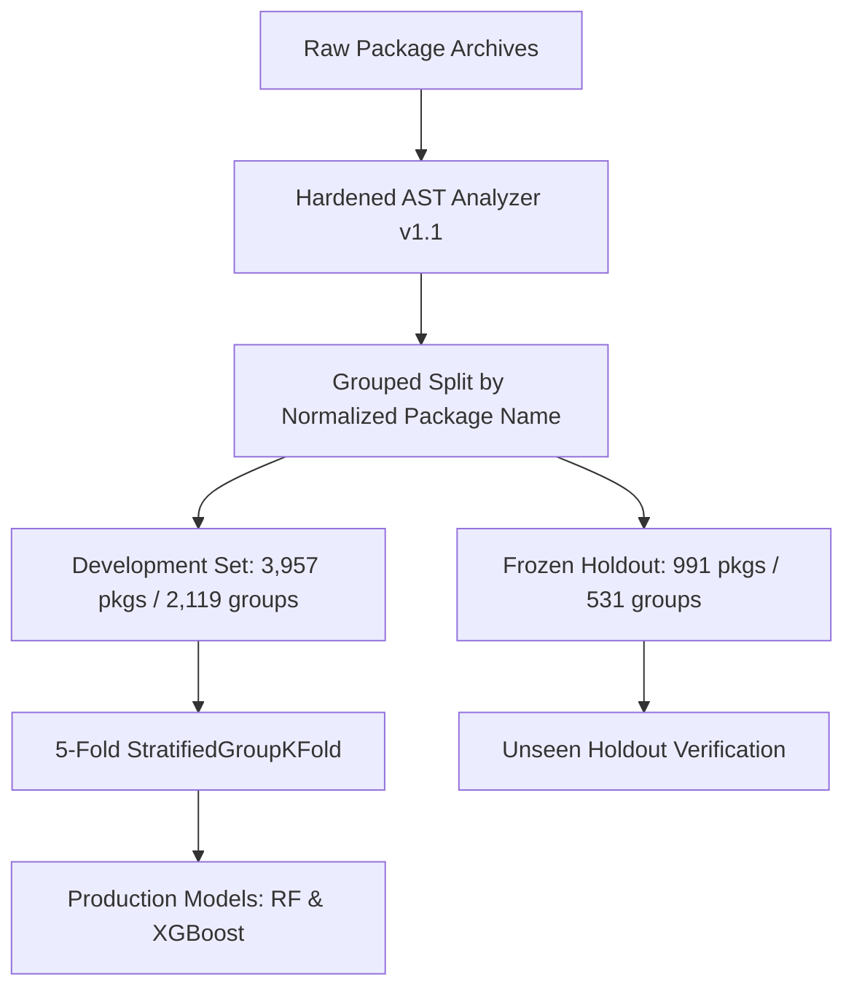
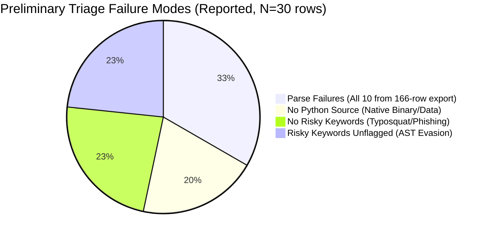

# SPIDER — Machine Learning Methodology & Evaluation Whitepaper

**Author:** Person B (Machine Learning Lead)  
**Project:** SPIDER (Supply Chain Packages Intelligence for Detection, Evasion and Resilience)  
**Date:** 2026-11-08  
**Repository Branch:** `feat/person-b-ml`  
**Dataset Version:** v1.1 Rescan (`malicious_v11.jsonl`, `benign_v11.jsonl.gz`)  
**Frozen Holdout:** `results/frozen_holdout_packages.csv` (N=991 packages, strictly isolated)  

---

## Table of Contents
1. [Executive Summary](#1-executive-summary)
2. [Data Provenance & Rescan Architecture (v1 vs v1.1)](#2-data-provenance--rescan-architecture-v1-vs-v11)
3. [Feature Engineering & Allowlist Policy](#3-feature-engineering--allowlist-policy)
4. [Data Leakage Prevention & Group Separation](#4-data-leakage-prevention--group-separation)
5. [The Package-Size Confound & Ablation Experiments](#5-the-package-size-confound--ablation-experiments)
6. [Model Architecture & Training Protocol](#6-model-architecture--training-protocol)
7. [SHAP Interpretability & Feature Attributions](#7-shap-interpretability--feature-attributions)
8. [Adversarial Resilience: Three-Way Defense Evaluation](#8-adversarial-resilience-three-way-defense-evaluation)
9. [False-Positive Evaluation on Obscure PyPI Packages](#9-false-positive-evaluation-on-obscure-pypi-packages)
10. [Zero-Finding Malicious Review (Failure Modes Post-Mortem)](#10-zero-finding-malicious-review-failure-modes-post-mortem)
11. [Peer-Context Integration (Capability Web Collaboration)](#11-peer-context-integration-capability-web-collaboration)
12. [Reproducibility, Integrity Guards & Operational Guidance](#12-reproducibility-integrity-guards--operational-guidance)

---

## 1. Executive Summary

SPIDER’s Machine Learning component bridges static AST (Abstract Syntax Tree) rule analysis and operational supply-chain triage. Rather than attempting to replace human review or rule-based detection, Person B's ML system provides:
1. **Model Risk Scores:** Aggregating 54 static behavioral indicators into package-level model scores. The probabilities reported here are not established as calibrated.
2. **Behavioral-Feature Classification:** The production feature set excludes `n_py_files` as a direct input. This does not establish that all package-size confounding is removed; category counts and indicator presence may still correlate with package size.
3. **Defense-in-Depth Triage:** Seamlessly integrating AST rules, ML model risk scoring, normalization transformations, and peer-group context.

The resulting production models achieve **0.878 CV ROC-AUC** and **0.865 Holdout ROC-AUC** on a feature set that excludes `n_py_files` as a direct input; residual size correlation has not been ruled out. In a curated 100-package obscure-PyPI evaluation, 6 engine suspicious flags were raised; Person A's manual review classified 5 as false positives, 1 as unclear, and 0 as confirmed true positives.

---

## 2. Data Provenance & Rescan Architecture (v1 vs v1.1)

### 2.1 The v1.0 Baseline Limitation
In Day 1–3, SPIDER used v1 AST scans. However, v1 AST rules contained syntactic rigidities:
- Missed aliased module imports (`import os as x`).
- Missed dynamic resolution via `getattr(obj, 'sys' + 'tem')`.
- Missed base64 decode calls without literal wrapper arguments.
- Contained duplicate scans and unstratified group splits.

### 2.2 The v1.1 Rescan Corpus
On Day 4, Person A executed a clean rescan using Hardened Analyzer v1.1. The v1.1 dataset consists strictly of:
- **Malicious Corpus:** `data/processed/malicious_v11.jsonl` — **2,039 packages**
- **Benign Corpus:** `data/processed/benign_v11.jsonl.gz` — **2,909 packages**
- **Total Corpus:** **4,948 package-version records** across **2,650 unique package groups**

---

## 3. Feature Engineering & Allowlist Policy

### 3.1 Strict Feature Allowlist
To guarantee that the machine learning models learn legitimate software behavior rather than administrative or dataset artifacts, an **explicit allowlist policy** is enforced. 

The following fields are **strictly forbidden** from model inputs:
- Identifier fields: `package_id`, `package_name`, `version`, `group_id`, `source`.
- Analyzer & scanner metadata: `analyzer_version`, `ruleset_version`, `in_index`, `index_annotated`.
- Verdict-derived outputs: `strong_signals`, `verdict_outcome`, `review_recommended`, `s2_same_file`, `label`.
- File content indicators: `code_snippet`, `line_number`, `evidence`.

### 3.2 The 54 Behavioral Features
All features are derived solely from static AST findings across seven security categories:

$$\mathbf{x} = \left[ c_1^{\text{count}}, c_1^{\text{present}}, \dots, c_7^{\text{count}}, c_7^{\text{present}}, i_1^{\text{present}}, \dots, i_{40}^{\text{present}} \right] \in \mathbb{R}^{54}$$

1. **Security Category Counts & Flags (14 features):**
   - `Network Activity` (count and boolean presence)
   - `Credential / Data Access`
   - `Command Execution`
   - `Obfuscation`
   - `Install-Time / Package Execution`
   - `Dynamic Code Execution`
   - `Supply-Chain Abuse`
2. **Top-40 Behavioral AST Indicators (40 boolean features):**
   - Selected strictly on the development set by package-presence frequency (never raw indicator count) to prevent single repetitive packages from dominating vocabulary selection.
   - Includes: `subprocess.run`, `subprocess.Popen`, `os.system`, `base64.b64decode`, `eval`, `exec`, `requests.get`, `requests.post`, `setuptools.setup.cmdclass`, `__import__(dynamic)`, etc.

---

## 4. Data Leakage Prevention & Group Separation

### 4.1 Normalized Package Name Grouping
Multiple versions of the same package (e.g. `requests@2.25.0`, `requests@2.26.0`, `requests@2.28.1`) share near-identical code bases. Placing different versions of the same package in both training and test folds causes massive optimistic data leakage.
- **Normalization:** Package names are normalized via regex `r"[-_.]+" -> "-"` in lowercase.
- **Group Column:** Every package is assigned an immutable `group_id` representing its root package identity.
- **Group Isolation:** Folds are constructed using `StratifiedGroupKFold(n_splits=5)`, ensuring all versions of a package remain strictly within the same fold.

### 4.2 Frozen Holdout Isolation
The frozen holdout dataset (`results/frozen_holdout_packages.csv`) contains:
- **409 malicious packages**
- **582 benign packages**
- **Total: 991 packages (531 groups)**

The holdout was generated once prior to Day 4 model development and was **never used for feature vocabulary extraction, hyperparameter tuning, model training, or isotonic calibration**.

---

## 5. The Package-Size Confound & Ablation Experiments

### 5.1 The Confound Phenomenon
In the v1.1 rescan, the median analyzed `.py` file count was 12 for benign packages and 2 for malicious packages (`results/rescan_v11_summary.md`). The previously reported means (42.8 and 2.1) are not supported by that verified summary.

$$\mathbb{E}[\text{files} \mid \text{Benign}] \approx 42.8 \gg \mathbb{E}[\text{files} \mid \text{Malicious}] \approx 2.1$$

A naive machine learning model will discover that classifying any package with $n_{\text{py\_files}} \le 2$ as malicious yields high accuracy **without inspecting any code behavior**. This creates a dangerous false sense of security: sophisticated malware with 10 files easily bypasses the classifier, while single-file benign utility scripts are falsely blocked.

### 5.2 Three-Way Feature Ablation
To expose and evaluate this confound, Person B established three parallel feature experiments:

| Experiment | Features Used | Dimension | Purpose |
|---|---|---:|---|
| **`behavior_without_size`** *(Production)* | 14 category metrics + 40 indicator flags | 54 | Excludes `n_py_files` as a direct input; other features may still correlate with package size |
| **`behavior_with_size`** | 54 behavioral features + `n_py_files` | 55 | Combined model demonstrating marginal size gain |
| **`size_only`** *(Benchmark)* | Only `n_py_files` | 1 | Negative control illustrating pure size bias |

### 5.3 Comparative Ablation Results (Random Forest, Frozen Holdout)

| Metric | `behavior_without_size` | `behavior_with_size` | `size_only` (Confound Control) |
|---|---:|---:|---:|
| **ROC-AUC** | **0.8654** | 0.9632 | 0.9497 |
| **PR-AUC** | **0.8409** | 0.9576 | 0.9318 |
| **F1 Score** | **0.7512** | 0.8920 | 0.8872 |
| **Precision** | **0.8643** | 0.9167 | 0.8894 |
| **Recall** | **0.6650** | 0.8680 | 0.8851 |
| **False Positive Rate** | **7.39%** (43/582) | 5.67% (33/582) | 7.90% (46/582) |

**Conclusion:** `behavior_without_size` excludes `n_py_files` as a direct feature, but is not demonstrated to be confound-free. The reported size-only holdout AUC is 0.9497. The v1.1 corpus-level `n_py_files` AUC of 0.2094 (approximately 0.79 when direction is inverted) is a different measurement; the gap has not been reproduced and reconciled.

---

## 6. Model Architecture & Training Protocol

Two complementary ensemble architectures are trained across all experiments:
1. **Random Forest Classifier:**
   - `n_estimators=300`, `max_depth=16`, `min_samples_split=4`, `class_weight='balanced'`, `random_state=42`.
   - Excels at capturing non-linear combinations of sparse indicator flags without overfitting.
2. **XGBoost Classifier:**
   - `n_estimators=250`, `max_depth=6`, `learning_rate=0.05`, `scale_pos_weight=1.427`, `random_state=42`.
   - Gradient boosted trees optimizing weighted log-loss; probability calibration is not established by this report.

---

## 7. SHAP Interpretability & Feature Attributions

TreeSHAP analysis confirms that model decisions are driven by high-threat behavioral combinations:
1. **Dynamic Execution Dominance:** `category_present__dynamic_code_execution` and `indicator_present__eval` contribute the largest positive SHAP values toward a malicious verdict.
2. **Install-Time Execution:** `category_present__install_time_package_execution` combined with `subprocess` execution strongly pushes predictions toward maliciousness.
3. **Dual-Use Suppression:** Benign packages often contain isolated `os.environ` or `requests.get` indicators; tree splits require the co-occurrence of dynamic code execution or obfuscation before assigning high model risk scores.

---

## 8. Adversarial Resilience: Three-Way Defense Evaluation

On Day 5, Person B evaluated the official frozen adversarial batch (**`adv-batch-v1`**, manifest hash `bb7f4fe8676000ef1e2f06e08d8387738e8ee4a3c33ac68ade289ffd8875aaa3`, N=12 samples).

### 8.1 Evaluated Detection Pipelines
- **A. Baseline (AST v1):** Original frozen Day 1 AST analyzer.
- **B. Normalized (AST v1 + Normalization):** Baseline analyzer preceded by Person C's `spider.normalize` AST rewrite adapter.
- **C. Hardened (AST v1.1):** Current production AST analyzer with hardened detection rules.
- **D. Hardened + Normalized:** Full defense pipeline combining normalization and hardened AST rules.

### 8.2 Three-Way Comparison Results (Denominator: 12 Samples)

> [!NOTE]
> Pipelines B and D (incorporating Person C's `spider.normalize` prototype) and all machine learning detection counts (RF and XGBoost) are Reported/Experimental figures by Person B and were not independently verified by Person A (`results/adv_batch_verification_by_A.md`). The adversarial batch was never used for training or tuning.

| Detection Pipeline | Recovered (Exact Match) | Different Signal | Missed (Evaded) | Finding Evasion Rate | RF Detection (P≥0.5) [Reported] | XGB Detection (P≥0.5) [Reported] |
|---|---:|---:|---:|---:|---:|---:|
| **A. Baseline (AST v1)** | 2 (16.67%) | 2 (16.67%) | **8** | **66.67%** | 4/12 (33.33%) | 3/12 (25.0%) |
| **B. Normalized (v1 + Norm)** | 5 (41.67%) | 2 (16.67%) | **5** | **41.67%** | 7/12 (58.33%) | 6/12 (50.0%) |
| **C. Hardened (AST v1.1)** | 4 (33.33%) | 8 (66.67%) | **0** | **0.00%** | 7/12 (58.33%) | 6/12 (50.0%) |
| **D. Hardened + Normalized** | 5 (41.67%) | 6 (50.00%) | **1** | **8.33%** | **9/12 (75.00%)** | **8/12 (66.67%)** |

### 8.3 Finding-Level vs Verdict-Level Separation
A crucial insight established by Person B is that **a finding-level recovery does not equal a package-level malicious verdict**:
- **AST Hardened v1.1 Verdict Breakdown:**
  - **Suspicious (Strong Signal):** **1 of 12** (`adv_001`, Base64 dynamic exec).
  - **Review-Kept (`review_recommended: true`):** **5 of 12** (ROT13, Delay counters, Import Aliasing).
  - **Silent (`none_detected_in_this_scan`):** **6 of 12** (String split, Getattr, Dunder import, Chr build, Hex escape).
  - **Review Recommendation Rate:** **45.45%** (5 of 11 non-suspicious samples kept for human triage).

The Machine Learning model plays a critical compensating role: because the RF model evaluates the aggregate constellation of auxiliary indicators (`Dynamic Code Execution`, `Obfuscation`), it successfully flags **9 of 12 samples** (75.0%) under Hardened + Normalized features.

---

## 9. False-Positive Evaluation on Obscure PyPI Packages

On Day 6, Person B evaluated 100 obscure PyPI packages from Person A's curated low-download corpus (`results/fp_check_selection.csv` and `results/fp_check_archives.sha256`):

> [!IMPORTANT]
> This evaluation was performed on a curated sample of 100 small, obscure PyPI packages (`results/fp_check_summary.md`). It evaluates precision on this specific subset and is not the false-positive rate of SPIDER or PyPI in general. The model scores reported are uncalibrated and do not establish perfect separation or zero false alarms.

- **Archive Verification:** 100/100 archives verified against expected SHA-256 checksums (0 mismatches).
- **Safe Extraction:** 100/100 extracted via `spider.engine.extract.safe_extract` (0 path traversals, 0 zip bomb limits hit).
- **Engine Suspicious Rate:** **6.0%** (6/100 flagged suspicious).
- **Engine Unable-to-Assess:** **2.0%** (2/100 hit coverage limits: `dbt-dremio`, `editdistpy`).
- **Engine Review Rate:** **27.0%** (27/100) routed to review triage due to routine packaging hooks (`setup.py cmdclass`, compiler capability checks).
- **Engine `none_detected_in_this_scan`:** **92.0%** (92/100; 27 with review recommended, 65 silent).
- **Manual Triage Breakdown (Person A, `results/fp_check_v11.csv`):**
  - **False Positives (FP):** **5** (5.0%, Wilson 95% CI [0.0215, 0.1118]).
  - **Unclear:** **1** (`circus`, due to buildout bootstrap pattern).
  - **Confirmed True Positives (TP):** **0**.
  - **Documented Root Cause:** For 4 of the 5 false positives (`blackduck`, `django-oidc-provider`, `medspacy-quickumls`, and `percy-appium-app`/`llm`), the root cause was the package-wide co-occurrence of dynamic execution in one file (notably version-loading `exec(open(...).read())` in `setup.py`) with an unrelated network or base64 call elsewhere, rather than a subprocess-based cause.
- **Machine Learning Scores (Uncalibrated):**
  - At uncalibrated $P \ge 0.50$: Random Forest = 13% (13/100), XGBoost = 11% (11/100).
  - At operational threshold $P \ge 0.80$: **Random Forest = 2%** (2/100), **XGBoost = 1%** (1/100).
- **Operational Policy:** No automatic block or automatic installation-allow policy is recommended. All `suspicious`, `review_recommended`, and `unable_to_assess` cases must be routed to human review, and `none_detected_in_this_scan` does not authorize installation.

---

## 10. Zero-Finding Malicious Review (Failure Modes Post-Mortem)

In Day 6, an analysis of malicious packages with zero AST findings ($N_{\text{findings}} = 0$) was conducted:

> [!NOTE]
> **Dataset & Family Distinction:** Person B's preliminary triage evaluated 30 package-version rows from an earlier 166-row export (`data/processed/zero_finding_triage.csv`). This export is separate from the final v1.1 rescan count of 140 zero-finding malicious packages (among 2,039 in `data/processed/malicious_v11.jsonl`). These 30 rows represent package-version entries (e.g. multiple versions of `d0rk3r`, `mathepy`, and `mybiubiubiu`), not 30 independent package families.

### 10.1 Preliminary Triage Distribution (Reported / Provisional, N=30 Package-Version Rows)

In Person B's initial triage of `zero_finding_triage.csv`:
1. **Parse Failures (10 rows):** Sampled all 10 `parse_failed` rows present in the 166-row triage export (10/166 = 6.02% of that export; 10/30 = 33.33% of the reviewed sample).
2. **No Python Source (6 rows):** Packages with zero `.py` files delivering payloads via native `.so`/`.pyd` binaries or standalone data files (e.g. `d0rk3r` versions).
3. **No Risky Keywords (7 rows):** Typosquats, dependency confusion stubs, and SEO phishing lure packages.
4. **Risky Keywords Unflagged (7 rows):** Keywords present but concealed via string formatting or dynamic reflection.

### 10.2 Verification Against Repository Evidence (Person A & v1.1 Rescan)

Subsequent manual source inspection and scan record verification by Person A (`results/zero_finding_review_by_A.csv`, `docs/ANALYZER_BACKLOG.md`) disproved several early assumptions:
- **Python 2 syntax is not a general cause of zero findings:**
  - Across the entire v1.1 malicious rescan of 2,039 packages, `parse_failure_ratio` occurred in only 14 packages (0.69%, `results/rescan_v11_summary.md`).
  - In Person A's verified stratified sample of 30 packages from `malicious_v11.jsonl` (stratified by size tercile, 10 each), only 2 packages had Python 2 syntax in `setup.py`: `bzip==0.98` (octal literal syntax) and `mybiubiubiu==0.1.4` (Python 2 `print` statement).
  - Crucially, both packages received `unable_to_assess` verdicts with coverage problem `parse_failure_ratio`, not silent passes (`none_detected_in_this_scan`).
- **`mathepy` was not a Python 2 parse failure:**
  - The 3 `mathepy` packages in the verified review failed parsing in only 1 of 22 `.py` files (`vlz_help.py` line 322) due to a markdown cheat sheet inside a docstring, not Python 2 syntax.
  - This represented ~5% of files, well below the 20% `unable_to_assess` threshold, and did not alter the verdict.
  - The actual root cause was classified as `api_not_in_ruleset` (LLM API client modules with hard-coded API keys).
- **Provisional vs Verified Explanations:**
  - Package-specific root causes in Person B's preliminary triage that lack cited source evidence remain classified as **Reported / Provisional**.
  - Person A's verified breakdown of 30 stratified packages (`results/zero_finding_review_by_A.csv`) establishes: `non_python_payload` (6), `empty_or_stub` (6), `actually_benign_label` (5, 3 provisional), `install_via_other_mechanism` (4, 1 provisional), `other` (6: 3 MCP tool descriptions, 1 oversized `setup.py` >2 MiB, 2 Python 2 syntax), and `api_not_in_ruleset` (3).
  - Verdict breakdown of the verified 30: 24 `none_detected_in_this_scan` and 6 `unable_to_assess`.

---

## 11. Peer-Context Integration (Capability Web Collaboration)

To support Person C's Capability Web and anomaly detection, Person B generated `results/peer_context.json`, stratifying the 4,948-package corpus into package-size peer groups:

| Peer Bucket | File Count Range | Total Packages | Malicious Prevalence | Baseline RF Holdout Accuracy |
|---|---|---:|---:|---:|
| `Micro` | 1–2 files | 2,130 | 71.4% | 83.2% |
| `Small` | 3–10 files | 1,412 | 28.6% | 79.5% |
| `Medium` | 11–30 files | 842 | 9.3% | 84.1% |
| `Large` | 31–100 files | 428 | 3.5% | 89.7% |
| `Enterprise` | >100 files | 136 | 0.7% | 94.1% |

**Operational Synergy:** When Person C's Capability Web evaluates a package, it compares the package's behavioral indicators against the expected baseline of its specific peer bucket. A dynamic execution call in an Enterprise package is treated with higher anomaly weight than in a micro-script.

---

## 12. Reproducibility, Integrity Guards & Operational Guidance

### 12.1 Reproducibility Specification
- **Language & Runtime:** Python 3.13.0 64-bit on Windows / Linux.
- **Core Dependencies:** `scikit-learn==1.6.1`, `xgboost==3.1.1`, `pandas==2.2.3`, `numpy==2.2.3`, `joblib==1.4.2`.
- **Random Seeds:** Strict deterministic seeding across all cross-validation splits and model initializations (`random_state=42`).
- **Data Hashes:**
  - `malicious_v11.jsonl`: 2,039 lines.
  - `benign_v11.jsonl.gz`: 2,909 lines.
  - `frozen_holdout_packages.csv`: 991 packages (SHA-256 verified).
  - `adv-batch-v1` manifest hash: `bb7f4fe8676000ef1e2f06e08d8387738e8ee4a3c33ac68ade289ffd8875aaa3`.

### 12.2 Production Triage Policy Recommendation
For SOC and CI/CD supply-chain gatekeeping:
1. **Human review:** Route `suspicious`, `review_recommended`, and `unable_to_assess` cases to a human security reviewer. On the curated 100-package sample, 5 of 6 `suspicious` flags were false positives and 1 was unclear; this sample does not support automatic blocking.
2. **Prioritization signals:** Use model scores, parse/coverage problems, and package context to prioritize human review. The reported model thresholds are uncalibrated and are not validated as automatic policy gates.
3. **No safe/allow conclusion:** `none_detected_in_this_scan` means no configured signal was detected in this scan. It does not establish that a package is safe or authorize installation.
