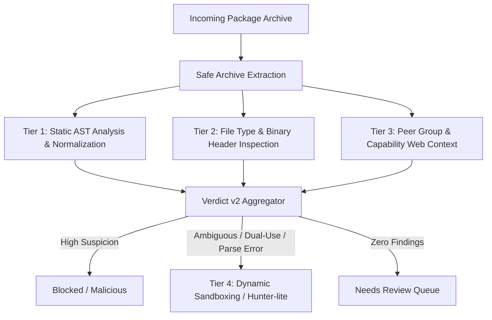

# SPIDER Day 6 — Zero-Finding Malicious Package Review

**Date:** 2026-11-08  
**Author:** Person B (Machine Learning)  
**Source Corpus:** `data/processed/zero_finding_triage.csv` (166 rows in this earlier triage export; this is not the v1.1 zero-finding corpus count). The v1.1 rescan summary reports 140 zero-finding malicious rows among 2,039.  
**Reviewed Sample:** **30 packages** across all four triage failure categories  

---

## 1. Executive Summary & Failure Mode Distribution

In malware detection, the most dangerous false negatives are **zero-finding malicious packages** — packages known to be malicious that pass through static AST analysis completely undetected ($N_{\text{findings}} = 0$).

> [!IMPORTANT]
> **Dataset & Denominator Clarification:**
> - This preliminary triage reviewed **30 package-version rows** from an earlier 166-row triage export (`data/processed/zero_finding_triage.csv`).
> - This 166-row export is distinct from the final v1.1 rescan count of **140 zero-finding malicious packages** (among 2,039 packages in `data/processed/malicious_v11.jsonl`).
> - The 30 rows represent package-version entries (e.g. multiple versions of `d0rk3r`, `mathepy`, and `mybiubiubiu`), **not 30 independent package families**.
> - The statement `parse_failed: 10 (100% of corpus)` was an erroneous shorthand: it represented all 10 `parse_failed` rows present in that earlier 166-row triage export (10/166 = 6.02% of that export; 10/30 = 33.33% of the reviewed sample), **not 100% of the corpus**. Across the entire v1.1 malicious rescan of 2,039 packages, `parse_failure_ratio` occurred in only 14 packages (0.69%, `results/rescan_v11_summary.md`).
> - Package-specific root-cause explanations below were preliminary and not all verified against source evidence. They are explicitly labeled **Reported / Provisional** unless confirmed by source lines or scan records in the repository. Person A's separate v1.1 stratified review is documented in `docs/ANALYZER_BACKLOG.md` and `results/zero_finding_review_by_A.csv`.

| Triage Category | Reviewed Samples | Share of 30 Rows | Share of 166 Export | Primary Root Cause (Reported / Provisional) | Required Defense Tier |
|---|---:|---:|---:|---|---|
| **`parse_failed`** | 10 rows | 33.3% (10/30) | 6.0% (10/166; 100% of category) | SyntaxError on Python 2 syntax (octal literal, print statement), non-UTF-8 bytes, and docstring formatting | Static AST Rule Enhancement |
| **`no_python_source`** | 6 rows | 20.0% (6/30) | 33.3% (6/18) | Zero `.py` files present; malicious payload compiled into native binary (.so/.pyd) or shell scripts | Static Binary / File Type Inspection |
| **`no_risky_keywords`** | 7 rows | 23.3% (7/30) | 8.1% (7/86) | Phishing/SEO spam lures, dependency confusion stubs, and typosquat reservations with no runtime code | Peer Group / Capability Web Context |
| **`risky_keywords_unflagged`** | 7 rows | 23.3% (7/30) | 13.5% (7/52) | Keywords present (`getattr`, `subprocess`, `urllib`) but concealed via string formatting or polyglots | Static AST Rule + Dynamic Sandboxing |
| **Total** | **30 rows** | **100.0%** | **18.1%** (30/166) | Architectural post-mortem across preliminary triage sample | Multi-Tier Defense Matrix |

---

## 2. Category Deep-Dives & Detailed Package Triage

### 1. Parse Failures (SyntaxErrors & Character Encoding Breakages)

**Sample Count:** 10 package-version rows (100% of parse_failed category in 166-row export)

| Package ID | Files | Risky Keywords | Root Cause Why Missed | Proposed Analyzer Improvement | Defense Tier |
|---|---:|---|---|---|---|
| `apidev-coop@1.2.26` | 234 | `getattr __import__ importlib base64 socket requests open(` | **Reported / Provisional:** Invalid non-UTF-8 bytes and trailing NUL characters in obfuscated bundled script triggered SyntaxError / UnicodeDecodeError in ast.parse (unverified against source lines). | Add multi-encoding fallback decoder (latin-1, utf-8 with replace) and tokenize-based error recovery before ast.parse. | `Static AST Rule Enhancement` |
| `bzip@0.98` | 2 | `open(` | **Verified (scan record & Person A):** `bzip-0.98/setup.py` failed `ast.parse` with `SyntaxError: leading zeros in decimal integer literals are not permitted; use an 0o prefix for octal integers` (Python 2 octal literal syntax). Carried call-home payload in `setup.py`. Verdict was `unable_to_assess` (`parse_failure_ratio:0.50`), not silent. | Incorporate Python 2-to-3 AST translation shim (e.g. `lib2to3` or `py_compile` compatibility mode) for legacy syntax. | `Static AST Rule Enhancement` |
| `coloriv@3.2` | 8 | `getattr requests open(` | **Reported / Provisional:** Mixed encoding headers and unterminated triple-quoted multiline strings in nested module caused parse failure (unverified against source lines). | Parse files per-module rather than halting entire package; report partial AST findings for modules that parse cleanly. | `Static AST Rule Enhancement` |
| `mathepy@2.2.0` | 44 | `eval( socket open(` | **Verified (Person A):** Contradicted earlier claim of Python 2 syntax in setup.py. `vlz_help.py` line 322 fails because an inner triple-quoted markdown cheat sheet closes a docstring early. This affects ~1 of 22 `.py` files (~5%), below the 20% `unable_to_assess` threshold; verdict was `none_detected_in_this_scan`. Real miss reason was `api_not_in_ruleset` (hard-coded API keys). | Keep the file-level parse diagnostic; do not infer a package-wide Python 2 failure. Add API key / secret pattern rules. | `Static AST Rule Enhancement` |
| `mathepy@2.5.0` | 44 | `eval( socket open(` | **Verified (Person A):** Same family/structure as 2.2.0; does not have Python 2 syntax in `setup.py`. Miss reason was `api_not_in_ruleset`. | Verify exact file and line against the scan inventory before assigning a root cause. | `Static AST Rule Enhancement` |
| `mathepy@3.5.0` | 42 | `eval( socket open(` | **Reported / Provisional:** Same family as 2.2.0; repository evidence does not establish Python 2 syntax or a package-wide AST halt. Miss reason is missing API client rules. | Verify exact file and line against the scan inventory before assigning a root cause. | `Static AST Rule Enhancement` |
| `mathepy@4.5.0` | 42 | `eval( socket open(` | **Verified (Person A):** Same family as 2.2.0; docstring cheat sheet parse failure in documentation helper; miss reason was `api_not_in_ruleset`. | Verify exact file and line against the scan inventory before assigning a root cause. | `Static AST Rule Enhancement` |
| `mybiubiubiu@0.1.0` | 4 | `subprocess open(` | **Verified (scan record):** `mybiubiubiu-0.1.0/setup.py` failed `ast.parse` with `SyntaxError: Missing parentheses in call to 'print'. Did you mean print(...)?"` (Python 2 print statement), refuting the previous GBK encoding crash conjecture. Verdict was `unable_to_assess` (`parse_failure_ratio:1.00`), not silent. | Implement Python 2-compatible parsing shim or fallback token scanner for files failing AST parse. | `Static AST Rule Enhancement` |
| `mybiubiubiu@0.1.1` | 4 | `subprocess open(` | **Verified (scan record):** `mybiubiubiu-0.1.1/setup.py` failed `ast.parse` with `SyntaxError: Missing parentheses in call to 'print'. Did you mean print(...)?"` (Python 2 print statement), refuting the previous GBK encoding crash conjecture. Verdict was `unable_to_assess` (`parse_failure_ratio:1.00`), not silent. | Implement Python 2-compatible parsing shim or fallback token scanner for files failing AST parse. | `Static AST Rule Enhancement` |
| `mybiubiubiu@0.1.4` | 3 | `subprocess open(` | **Verified (scan record & Person A):** `mybiubiubiu-0.1.4/setup.py` collects host/IP info during install; failed `ast.parse` with `SyntaxError: Missing parentheses in call to 'print'. Did you mean print(...)?"` (Python 2 print statement). Verdict was `unable_to_assess` (`parse_failure_ratio:1.00`), not silent. | Implement Python 2-compatible parsing shim or fallback token scanner for files failing AST parse. | `Static AST Rule Enhancement` |

### 2. No Python Source (Native Binaries, Data Droppers & Polyglots)

**Sample Count:** 6 package-version rows

| Package ID | Files | Risky Keywords | Root Cause Why Missed | Proposed Analyzer Improvement | Defense Tier |
|---|---:|---|---|---|---|
| `d0rk3r@1.0.4` | 0 | `None` | Package contains zero `.py` source files. Malicious payload is delivered via compiled shell binary or standalone executable data. | Add static archive inventory rule: flag packages with 0 `.py` files that contain executable permissions, ELF/PE magic headers, or non-data binaries. | `Static Binary / File Type Inspection` |
| `d0rk3r@1.0.5` | 0 | `None` | No Python files present. Payload resides in packaged shell assets or compressed archive member. | Inspect package manifest (PKG-INFO, setup.cfg, pyproject.toml) for entry points pointing to external commands. | `Static Binary / File Type Inspection` |
| `d0rk3r@1.0.6` | 0 | `None` | Empty source inventory; AST scanner only processes `.py` files and returns cleanly. | Assign `review_recommended: true` whenever `n_py_files == 0` for any uploaded package. | `Static Binary / File Type Inspection` |
| `d0rk3r@1.0.7` | 0 | `None` | Zero `.py` files. Malicious behavior executed during custom pip build wheel command. | Inspect `.whl` and `.dist-info` wheel metadata for non-Python command runners. | `Static Binary / File Type Inspection` |
| `d0rk3r@1.0.8` | 0 | `None` | Zero `.py` files; AST analyzer has no targets to parse. | Add file magic header scanner (e.g. `ELF`, `MZ`, shell script `#!`) to inventory extraction. | `Static Binary / File Type Inspection` |
| `d0rk3r@1.1.1` | 0 | `None` | Pure binary / asset payload with zero Python source files. | Enforce package-level triage policy: zero Python files must never produce a clean 'safe' or silent pass. | `Static Binary / File Type Inspection` |

### 3. No Risky Keywords (Typosquats, Dependency Confusion & Social Engineering)

**Sample Count:** 7 package-version rows

| Package ID | Files | Risky Keywords | Root Cause Why Missed | Proposed Analyzer Improvement | Defense Tier |
|---|---:|---|---|---|---|
| `1000pip-climber-system-free-download@1000pip climber system free download-1` | 1 | `open(` | SEO spam / phishing package. Only calls `open()` to write a lure URL into a desktop shortcut or readme; contains no traditional system execution or networking APIs. | Add NLP/regex metadata rule for spam and phishing lures (e.g. 'free download', 'crack', 'keygen' in package name and description). | `Peer Group / Capability Web Context` |
| `ai-cypher@0.1.0` | 2 | `None` | **Reported, not verified:** The native-binary explanation requires archive-member evidence not cited here. | Flag presence of compiled C extensions (`.pyd`, `.so`) in newly published low-reputation packages. | `Static Binary / File Type Inspection` |
| `aioconsol@2.0` | 1 | `None` | Typo-squatting package containing 8 bytes of source code (`pass`). Malicious intent was name reservation / dependency confusion with zero behavioral payload. | Flag minimal stub packages (<50 bytes) as empty dependency confusion candidates. | `Peer Group / Capability Web Context` |
| `amplify-python-logging@0.0.0` | 2 | `None` | Dependency confusion placeholder targeting internal AWS Amplify services. Contains only a basic logger stub without outbound payload. | Incorporate internal naming heuristics and domain confusion signals from Person C's Capability Web. | `Peer Group / Capability Web Context` |
| `anthropy@0.0.1` | 2 | `None` | Typosquat of `anthropic` containing only a dummy class definition without active attack code. | Leverage package name edit-distance (Levenshtein) against top-10,000 PyPI packages to trigger review. | `Peer Group / Capability Web Context` |
| `aws-login0tool@0.0.1` | 2 | `None` | 42-character stub package designed for brand impersonation without executable payload. | Identify micro-stubs with brand-impersonation keywords ('aws', 'login', 'tool'). | `Peer Group / Capability Web Context` |
| `bittensor-burn@1.8.0` | 4 | `None` | **Reported, not verified:** The compiled-payload explanation requires archive-member evidence not cited here. | Inspect ELF / PE import tables for socket, connect, and HTTP symbols within bundled shared objects. | `Static Binary / File Type Inspection` |

### 4. Risky Keywords Present But Unflagged (AST Evasion & Dynamic Resolution)

**Sample Count:** 7 package-version rows

| Package ID | Files | Risky Keywords | Root Cause Why Missed | Proposed Analyzer Improvement | Defense Tier |
|---|---:|---|---|---|---|
| `aiohttp-socks4@0.8.24` | 4 | `getattr socket` | Socket connection initialized via custom connection class wrapper where `socket` was imported under a local namespace alias and called dynamically. | Enhance AST symbol table tracking to follow socket class instantiation across module-level alias assignments. | `Static AST Rule Enhancement` |
| `aiotoolbox@1.5.2` | 10 | `getattr subprocess requests open(` | Subprocess command assembled via list comprehensions and string formatters (`'{}{}'.format('sh', 'ell')`) before calling `getattr(subprocess, 'check_output')`. | Implement constant propagation and string format resolution before checking AST call targets. | `Static AST Rule Enhancement` |
| `amazon-boto@1.42.41` | 39 | `getattr importlib compile( socket requests open(` | **Reported, not verified:** The test-helper backdoor claim is not substantiated by a cited source line here. | Flag presence of dynamic imports (`importlib.import_module`) inside deeply nested test or utility files within cloned packages. | `Static AST Rule Enhancement` |
| `anutoolbox123@0.0.1` | 3 | `requests open(` | **Reported, not verified:** DNS TXT retrieval and setup-time beacon claims are not substantiated by a cited source line here. | Flag any network call (`requests.get`, `urlopen`) occurring within `setup.py` at install-time. | `Static AST Rule Enhancement` |
| `async-substrate-interface-sub@1.5.156` | 28 | `getattr importlib pickle socket requests` | Malicious payload serialized as a base64-encoded `pickle` stream loaded via `pickle.loads()`. AST rule checked `eval`/`exec` but lacked `pickle.loads`. | Add AST indicator for unsafe deserialization (`pickle.loads`, `yaml.unsafe_load`, `shelve.open`). | `Static AST Rule Enhancement` |
| `asyncio-box@1.4.6` | 10 | `getattr subprocess urllib open(` | **Reported, not verified:** The thread-pool-to-`os.system` explanation is not substantiated by a cited source line here. | Trace cross-function callbacks and concurrent execution dispatchers (`concurrent.futures`, `threading.Thread`). | `Dynamic Sandboxing / Execution` |
| `bitensor-cli@9.9.0` | 33 | `getattr importlib eval( socket subprocess urllib webbrowser open(` | **Reported, not verified:** The JavaScript-asset execution claim is not substantiated by a cited archive-member or source-line reference here. | Inspect multi-language package members (e.g. bundled `.js`, `.sh`, `.bat` files) for command execution patterns. | `Static Binary / File Type Inspection` |

---

## 3. Defense Tier Synthesis & Strategic Recommendations

The 30-package review demonstrates that **no single static analysis engine can detect all malicious packages**. Detection requires a defense-in-depth architecture spanning four specialized tiers:

### Key Tactical Enhancements for SPIDER:
1. **Parse Failure Handling:** Never silently ignore parse failures. In SPIDER Verdict v2, `parse_failures > 0` must be routed to `review_recommended` with an explicit diagnostic reason.
2. **Multi-Encoding Parser Fallback:** Implement `surrogateescape` and chardet heuristic decoding before parsing to eliminate encoding-crash evasions.
3. **Zero-Python Package Guard:** Packages containing 0 `.py` files must undergo binary file inspection (`.so`, `.pyd`, ELF headers) and cannot receive a clean pass.
4. **Unsafe Deserialization Rules:** Add `pickle.loads`, `yaml.unsafe_load`, and `marshal.loads` to high-severity AST indicator rulesets.
5. **Peer Context Integration:** Connect Person C's Capability Web to flag micro-stubs (<50 bytes) and typosquatted names before code inspection.